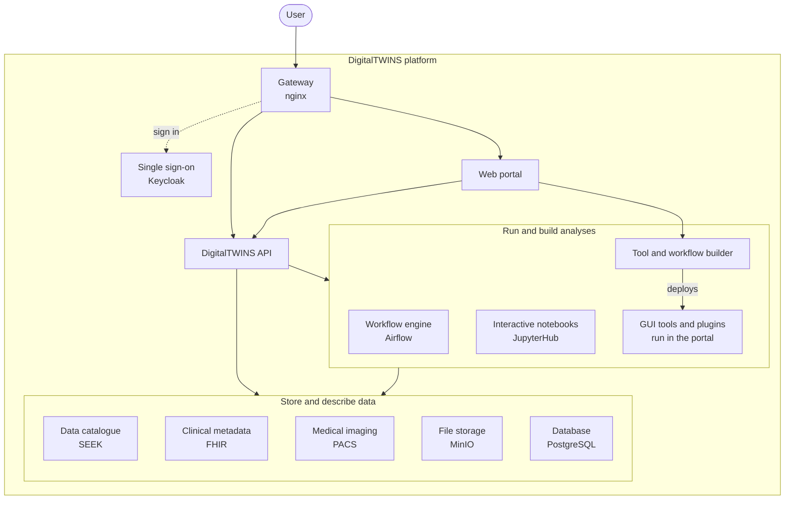
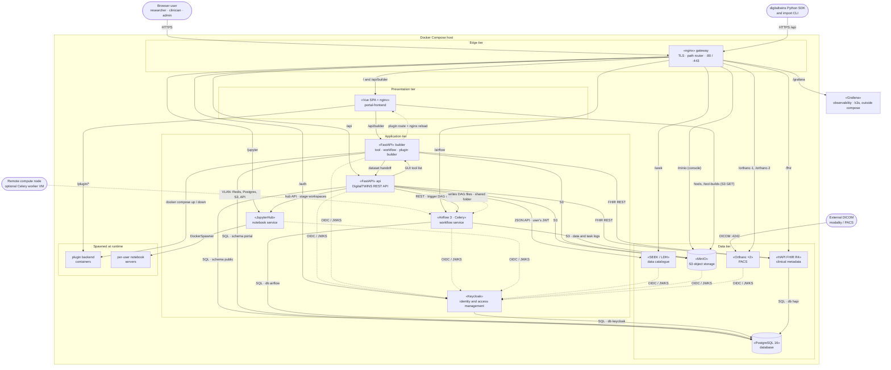
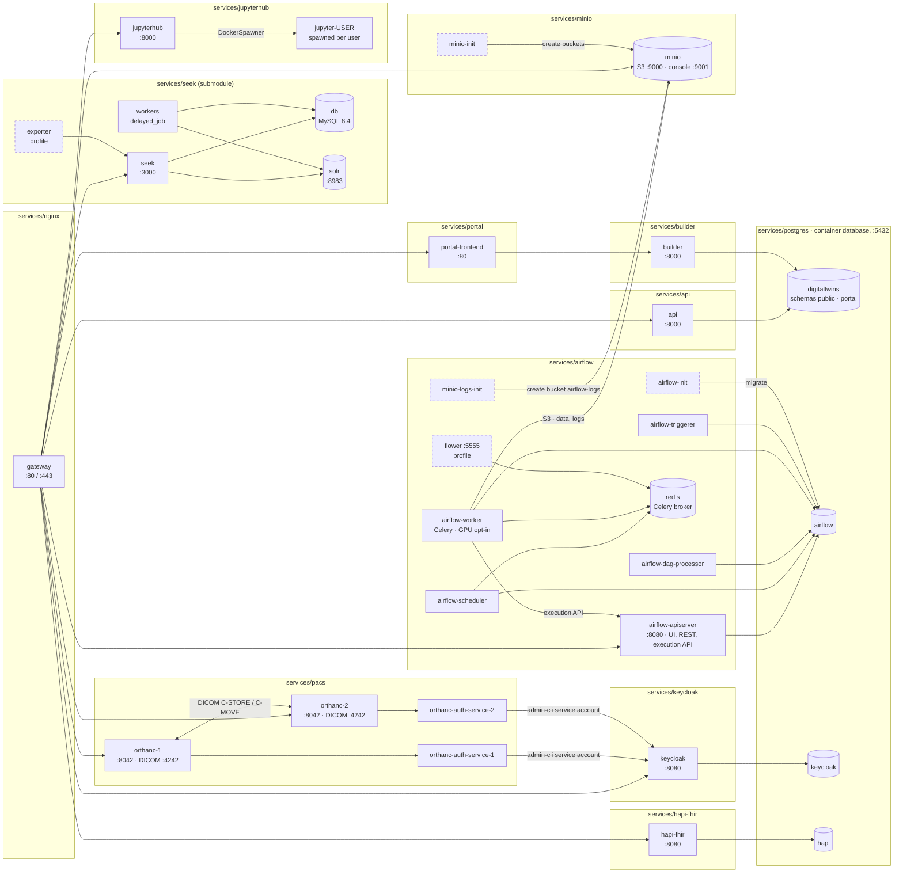

# DigitalTWINS platform architecture

The platform is a single Docker Compose project: the root `docker-compose.yml`
extends or includes each service under `services/`, and every container joins one
bridge network, `${PROJECT_NAME}`. The nginx `gateway` is the only public entry
(ports 80/443). It terminates TLS and routes by path to each service. Keycloak
(realm `digitaltwins`, served at `/auth`) is the single sign-on provider for every
user-facing app. A single PostgreSQL container holds the databases for the API,
the builder, Airflow, Keycloak and HAPI FHIR. SEEK keeps its own MySQL and Solr.

Three views follow, from least to most detailed:

- **[Overview](#overview):** what the platform does, for readers new to the
  project.
- **[Service view](#service-view):** one box per platform service, in tiers, with
  the calls between them.
- **[Container view](#container-view):** every container each compose project
  starts, and how they connect inside the project.

See also:

- [codemap.md](codemap.md): where each service's code lives, and the settings
  services must agree on.
- [request-flows.md](request-flows.md): sign-in, dataset upload, assay launch
  and plugin deploy, step by step through the code.
- [glossary.md](glossary.md): the platform's terms.

## Overview

Users reach the platform through one gateway and sign in once with single
sign-on. The DigitalTWINS API ties the platform together: it records data in the
catalogue and clinical metadata stores, keeps files in object storage, and launches
analyses as workflows or interactive notebooks. The builder turns registered tools
and workflows into GUI tools and plugins, which open inside the web portal.

## Service view

Solid arrows are runtime calls, labelled with protocol or purpose. Dashed arrows
are OIDC/JWKS calls to Keycloak, shared files, or optional parts.

The portal SPA runs in the browser. It logs in through `/auth` (public client
`portal-frontend`) and calls `/api` and `/api/builder` with the user's bearer
token. Those requests reach the gateway on the "Browser user" arrow.

## Container view

Each box is one container. Labels give the in-network `host:port` that other
containers use. Most services also publish a host port for debugging (see each
`services/*/docker-compose.yml`); production should expose only the gateway (see
[production.md](production.md)). Dashed boxes are profile-only or one-shot
containers.

For clarity, this view leaves out the calls from `api` and `builder` to other
services (shown in the [service view](#service-view)) and the OIDC calls to Keycloak.
It also leaves out JupyterHub's `singleuser` compose service, which only builds the
per-user notebook image and exits.

## Services

| Service | Role | Source | Gateway path |
|---|---|---|---|
| gateway | TLS edge and path router. The only public entry. | `services/nginx` (stock nginx, bind-mounted config) | all |
| portal-frontend | Web portal. A Vue SPA, plus an nginx that proxies the builder, plugin bundles and plugin backends. | `services/portal` | `/` |
| api | DigitalTWINS REST API: datasets, assays, workflow deploy and launch, SEEK/FHIR/MinIO integration. Also published as the `digitaltwins` Python package. | `services/api` | `/api` |
| builder | Builds and deploys portal tools, workflows and plugins. The only service holding the Docker socket for that purpose. | `services/builder` | `/api/builder` |
| Airflow | Runs workflows as DAGs on Celery workers. The worker can have a GPU (opt-in). | `services/airflow` | `/airflow` |
| JupyterHub | Interactive analysis. Starts a notebook server per user. | `services/jupyterhub` | `/jupyter` |
| Keycloak | Identity and access management (OIDC), realm `digitaltwins`. | `services/keycloak` | `/auth` |
| SEEK (LDH) | Data catalogue for projects, studies, assays, SOPs and workflows. | `services/seek/ldh-deployment` (git submodule) | `/seek` |
| HAPI FHIR | FHIR R4 server for clinical metadata (datasets, models as `Device`, workflows as `PlanDefinition`). | `services/hapi-fhir` | `/fhir` |
| MinIO | S3 object storage for measurements, models, tools, workflows and Airflow logs. | `services/minio` | `/minio` (console) |
| PACS | Two Orthanc instances with de-identification, each with a Keycloak-backed auth service. | `services/pacs` | `/orthanc-1`, `/orthanc-2` |
| PostgreSQL | Shared relational database. | `services/postgres` | none |
| Grafana | Observability, running in k3s on the host, outside compose. | `util/observability` | `/grafana` |

For the full route table see
[util/README.md §7](../util/README.md#7-gateway-proxy-routes-reference), and for
which login protects each path see
[gateway-pathway-access.md](gateway-pathway-access.md).

## Data stores

| Store | Used by |
|---|---|
| Postgres `digitaltwins` database, schema `public` | api (platform metadata: subjects, samples, datasets, assays) |
| Postgres `digitaltwins` database, schema `portal` | builder (tool, workflow and plugin registry) |
| Postgres `airflow` database | Airflow metadata and Celery result backend |
| Postgres `keycloak` database | Keycloak |
| Postgres `hapi` database | HAPI FHIR |
| SEEK MySQL (`db`) and Solr | SEEK only |
| MinIO buckets `measurements`, `models`, `workflows`, `tools` (public), `tool-builds` (anonymous download), `airflow-workspace`, `airflow-logs` | api, builder, Airflow, portal-frontend (plugin bundles) |
| JupyterHub SQLite and per-user volumes | JupyterHub |
| Orthanc storage volumes | orthanc-1, orthanc-2 |

## Keycloak clients

| Client | Type | Used by |
|---|---|---|
| `portal-frontend` | public | Portal SPA login |
| `api` | confidential, service account | api; the builder (token verification); Airflow DAGs and compute nodes (client credentials) |
| `airflow` | confidential | Airflow UI login |
| `jupyterhub` | confidential | JupyterHub login |
| `seek` | confidential | SEEK login, plus verifying the JWTs the API forwards |
| `minio` | confidential | MinIO console login |
| `orthanc` | public | Orthanc UI login |
| `admin-cli` | confidential, service account | Orthanc auth services |
| `grafana` | confidential | Grafana login |

Details: [services/keycloak/REALM.md](../services/keycloak/REALM.md) and
[seek-integration.md](seek-integration.md).

## Not part of the running stack

- `services/jupyterlab`: a single-user JupyterLab, replaced by JupyterHub. Its
  include is commented out.
- `services/pacs_pretend_external`: a test stand-in for an external PACS. Its
  include is commented out.
- `services/irods` and the API's iRODS and Gen3 client code: present but not
  configured.
- `pgadmin` (in `services/postgres`) and the `minio`, `hapi-fhir` and
  `hapi-fhir-postgres` services in `services/portal/docker-compose.yml`: the root
  compose `extends` only `database` and `portal-frontend`, so these never start
  under the platform.

## Related decisions

- [Builder as its own service](decisions/2026-10-21-builder-as-its-own-service.md)
- [API prefix and portal/builder split](decisions/2026-10-20-api-prefix-and-portal-builder-split.md)
- [Portal database in platform Postgres](decisions/2026-09-28-portal-database-in-platform-postgres.md)
- [One Keycloak token verifier](decisions/2026-10-21-one-keycloak-token-verifier.md)
- [SEEK just-in-time user provisioning](decisions/2026-10-14-seek-jit-user-provisioning.md)
- [Deploy-script workflow DAGs](decisions/2026-10-13-deploy-script-workflow-dags.md)
- [Airflow worker GPU opt-in](decisions/2026-10-23-airflow-worker-gpu-opt-in.md)
- [SEEK database on MySQL 8.4](decisions/2026-10-23-seek-database-mysql-8.4.md)

## Legacy diagram

[architecture_diagram_legacy.png](images/architecture_diagram_legacy.png) is the
original diagram from November 2025. It is out of date (for example, it shows
JupyterLab and has no gateway or builder) and is kept for history only.
