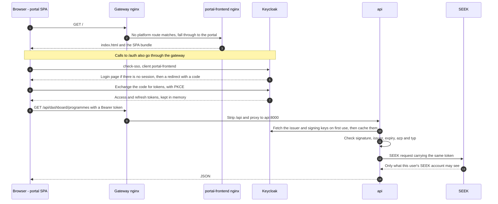
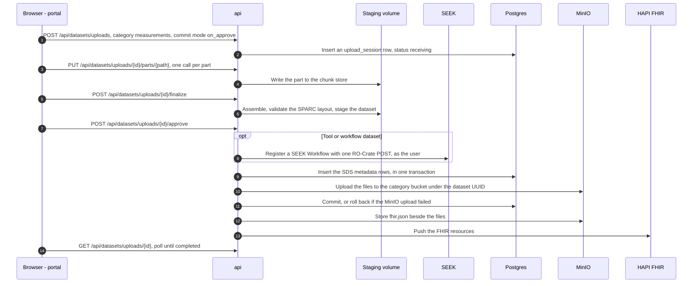
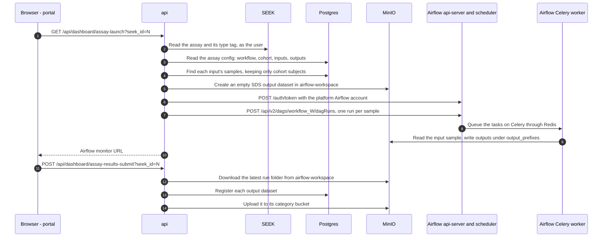
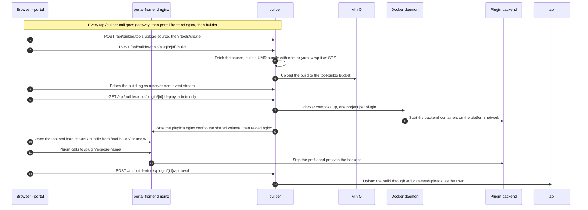

# How requests flow

Four journeys through the platform, traced through the code. Each diagram is
followed by numbered steps; the numbers match the arrows, and each step links
to the code that handles it. For where each service lives see
[codemap.md](codemap.md); for the static picture see
[architecture.md](architecture.md); for terms see [glossary.md](glossary.md).

Every browser request goes through the gateway (`services/nginx`). The first
diagram shows that hop; the others leave it out to save space. Paths are as the
browser sends them: the gateway strips `/api` before the API sees a request, so
`/api/datasets/uploads` reaches the API as `/datasets/uploads`.

- [Sign in and call the API](#sign-in-and-call-the-api)
- [Upload or import a dataset](#upload-or-import-a-dataset)
- [Launch an assay](#launch-an-assay)
- [Build and deploy a GUI tool or plugin](#build-and-deploy-a-gui-tool-or-plugin)

## Sign in and call the API

The portal signs the user in with Keycloak in the browser, then sends the access
token with every API call. The API checks the token itself and forwards it to
SEEK, so each request runs as that user.

1. The gateway has no platform route for `/`, so
   [`portal-fallback.conf`](../services/nginx/snippets/portal-fallback.conf)
   hands it to `portal-frontend` through
   [`portal-proxy.conf`](../services/nginx/snippets/portal-proxy.conf).
2. The same hop carries everything else the gateway doesn't route itself.
3. The portal's nginx serves the SPA (`location /` in
   [`nginx.conf.template`](../services/portal/frontend/nginx.conf.template)).
4. [`main.ts`](../services/portal/frontend/src/main.ts) calls `initKeycloak`
   in [`bootstrap/keycloak.ts`](../services/portal/frontend/src/bootstrap/keycloak.ts)
   before it mounts the app: `onLoad: 'check-sso'` with
   [`silent-check-sso.html`](../services/portal/frontend/public/silent-check-sso.html).
   The Keycloak URL (`/auth`), realm and client are build arguments in
   [`services/portal/docker-compose.yml`](../services/portal/docker-compose.yml).
   The gateway routes `/auth/` to `keycloak:8080`
   ([`platform-routes.conf`](../services/nginx/snippets/platform-routes.conf)).
5. The sign-in button calls `login()` in `keycloak.ts`
   ([`AuthNavBar.vue`](../services/portal/frontend/src/components/AuthNavBar.vue)).
   Pages that need a sign-in send an anonymous user to Home
   ([`router/index.ts`](../services/portal/frontend/src/router/index.ts)).
6. keycloak-js exchanges the code (`pkceMethod: 'S256'`).
7. Tokens stay in memory. `onTokenExpired` renews the access token with
   `updateToken(30)`, unless the idle warning is showing; `setupIdleTimeout`
   signs the user out after 30 idle minutes.
8. [`bootstrap/http.ts`](../services/portal/frontend/src/bootstrap/http.ts)
   adds `Authorization: Bearer <token>` to every request. `dtApiAxios`
   (base URL `/api`) calls the platform API; the default axios instance (base
   URL `/api/builder`) calls the builder. This call comes from
   [`bootstrap/dashboard_api.ts`](../services/portal/frontend/src/bootstrap/dashboard_api.ts).
9. `location /api/` in
   [`platform-routes.conf`](../services/nginx/snippets/platform-routes.conf)
   strips the prefix and proxies to `api:8000`.
10. The route's `validate_credentials` dependency calls `auth_bearer` and
    `verify_access_token` in
    [`app/routers/auth.py`](../services/api/app/routers/auth.py), which use
    `KeycloakVerifier` in
    [`core/keycloak_verifier.py`](../services/api/src/digitaltwins/core/keycloak_verifier.py).
    It fetches the realm's discovery document and keys from
    `KEYCLOAK_BASE_URL` (the internal address), caches them, and refetches at
    most once a minute for an unknown key id.
11. `verify` requires an RS256 token with `exp`, `iat`, `iss`, `azp` and `typ`;
    the issuer must match, `azp` must be `portal-frontend` or `api`, and `typ`
    must be `Bearer`. Failures return 401; an unreachable Keycloak returns 503.
    Routes that need a realm role add `require_upload_role` (admin or
    researcher) or `require_admin_role`.
12. `get_querier` in
    [`app/routers/dependencies.py`](../services/api/app/routers/dependencies.py)
    builds a per-request `Querier` holding the token.
    [`seek/querier.py`](../services/api/src/digitaltwins/seek/querier.py) sends
    it to SEEK as a Bearer token.
13. SEEK verifies the token and maps it to a SEEK user, creating the account
    the first time it sees that user. See
    [seek-integration.md](seek-integration.md).
14. If the API answers 401, `http.ts` refreshes the token once and retries;
    a second 401 tells the user the session has ended.

Other ways in:

- **HTTP Basic** (the CLI, scripts): `validate_credentials` also accepts a
  username and password. `get_token` in
  [`auth.py`](../services/api/app/routers/auth.py) trades them for a token at
  Keycloak with the `api` client (`KEYCLOAK_CLIENT_SECRET`), then verifies it
  like any other. `POST /api/login` returns that token.
- **The builder** checks the same tokens with its own copy of the verifier
  ([`app/client/keycloak.py`](../services/builder/app/client/keycloak.py)).

## Upload or import a dataset

The portal's measurements hub uploads a dataset in parts, stages it for review,
and commits it when the user approves. Models, tools and workflows use the same
upload sessions.

1. [`bootstrap/measurement_api.ts`](../services/portal/frontend/src/bootstrap/measurement_api.ts)
   creates the session with `commitMode: "on_approve"`. `create_upload` in
   [`app/routers/dataset_uploads.py`](../services/api/app/routers/dataset_uploads.py)
   requires the admin or researcher realm role, checks the category, and for a
   tool or workflow needs its type and `seek_project_id`.
2. [`measurements/sessions.py`](../services/api/src/digitaltwins/measurements/sessions.py)
   writes the `upload_session` row (table from migration
   [`0001`](../services/api/src/digitaltwins/postgres/migrations/0001_upload_session_and_fhir.sql)).
3. [`bootstrap/measurement_upload.ts`](../services/portal/frontend/src/bootstrap/measurement_upload.ts)
   sends the parts with bounded concurrency. An interrupted upload resumes from
   the parts the session reports as received.
4. `upload_part` writes each part through
   [`measurements/chunk_store.py`](../services/api/src/digitaltwins/measurements/chunk_store.py)
   to the API's `dataset_staging` volume.
5. `finalize_upload` checks that every part has arrived.
6. It assembles the files (unzipping an archive), then validates them:
   `validate_sparc_structure` in
   [`measurements/validation.py`](../services/api/src/digitaltwins/measurements/validation.py)
   for measurements, `validate_model_structure`, `find_tool_cwl` or
   `load_workflow` for the other categories. With `on_approve` the session
   becomes `staged`, and the portal can edit its FHIR draft through the
   `/datasets/uploads/{id}/fhir/...` routes. With `on_finalize`, the REST
   default, the commit starts straight away.
7. `approve_upload` queues `run_commit_and_push` in
   [`measurements/jobs.py`](../services/api/src/digitaltwins/measurements/jobs.py)
   as a background task and returns 202.
8. Tools and workflows only: `commit_tool` in
   [`tools/pipeline.py`](../services/api/src/digitaltwins/tools/pipeline.py)
   and `commit_workflow` in
   [`workflows/pipeline.py`](../services/api/src/digitaltwins/workflows/pipeline.py)
   register the dataset in SEEK as the user, with `register_tool` or
   `register_workflow` in
   [`seek/writer.py`](../services/api/src/digitaltwins/seek/writer.py), and
   undo it if a later step fails. Measurement and model datasets are not
   registered in SEEK.
9. `commit_dataset` in
   [`measurements/pipeline.py`](../services/api/src/digitaltwins/measurements/pipeline.py)
   calls `Uploader.upload_dataset` in
   [`core/uploader.py`](../services/api/src/digitaltwins/core/uploader.py),
   which maps the SDS metadata files to Postgres tables.
10. It uploads the folder to the MinIO bucket named after the category, under
    the new dataset UUID
    ([`minio/uploader.py`](../services/api/src/digitaltwins/minio/uploader.py)).
11. Postgres commits only if the MinIO upload succeeded.
12. If the session asked for FHIR, `run_fhir_push_job` builds `fhir.json`
    ([`measurements/fhir_service.py`](../services/api/src/digitaltwins/measurements/fhir_service.py))
    and `store_fhir_json` writes it to `<category>/<dataset_uuid>/fhir.json`.
13. It pushes the resources to HAPI FHIR (`FHIR_ENDPOINT`) and records the
    outcome in `dataset.fhir_status`. Models become a `Device`, tools an
    `ActivityDefinition`, workflows a `PlanDefinition`.
14. The portal polls the session. When an admin commits a script workflow,
    `run_commit_and_push` also deploys its DAG (`auto_deploy` in
    [`workflows/deploy.py`](../services/api/src/digitaltwins/workflows/deploy.py)).

Other ways in:

- **From a terminal on the server:** the
  [`scripts/import-dataset.*`](../services/api/scripts/) wrappers copy the
  dataset into the `api` container and run
  `python -m digitaltwins.cli.import_dataset`
  ([`cli/import_dataset.py`](../services/api/src/digitaltwins/cli/import_dataset.py)).
  It signs in with Keycloak, then runs the same validate, commit and FHIR steps
  in-process, with no HTTP upload. See
  [import-dataset.md](../services/api/docs/import-dataset.md).
- **From another machine:** `UploadClient` in
  [`client.py`](../services/api/src/digitaltwins/client.py) speaks the same
  session protocol over HTTP. `POST /api/datasets`
  ([`app/routers/datasets.py`](../services/api/app/routers/datasets.py)) takes
  a whole dataset in one request.

## Launch an assay

A script assay runs its workflow as an Airflow DAG, once per input sample. Its
results come back to the platform when the user submits them.

Before the launch:

- **The DAG is deployed.** `POST /api/workflows/{dataset_uuid}/deploy`
  ([`app/routers/workflows.py`](../services/api/app/routers/workflows.py)), or
  an admin's approval, runs
  [`workflows/deploy.py`](../services/api/src/digitaltwins/workflows/deploy.py).
  It fetches the workflow's `code/` from MinIO, checks it with
  [`workflows/dag.py`](../services/api/src/digitaltwins/workflows/dag.py),
  writes it to `services/airflow/dags/workflow_<seek_id>/` through the API's
  `/airflow-dags` bind mount, waits for Airflow to parse it, and unpauses it.
  See [workflow-dag-authoring.md](workflow-dag-authoring.md).
- **The assay is configured.** The portal's assay config dialog
  ([`AssayConfigDialog.vue`](../services/portal/frontend/src/views/dashboard/components/AssayConfigDialog.vue))
  saves through `useAssayActions.ts` and `POST /api/dashboard/assay-details` (`set_assay_details` in
  [`dashboard.py`](../services/api/app/routers/dashboard.py)), which calls
  `configure_assay` in [`assays.py`](../services/api/app/routers/assays.py).
  That links the workflow to the assay in SEEK through an auto-created SOP
  ([`core/assay_workflow_link.py`](../services/api/src/digitaltwins/core/assay_workflow_link.py)),
  then writes the `assay`, `assay_input` and `assay_output` rows. The dialog's
  participant selection becomes `assay.cohort`.

1. The assay card's launch button
   ([`composables/useAssayActions.ts`](../services/portal/frontend/src/composables/useAssayActions.ts))
   calls `useDashboardGetAssayLaunch` in
   [`bootstrap/dashboard_api.ts`](../services/portal/frontend/src/bootstrap/dashboard_api.ts).
   `launch_assay` in [`dashboard.py`](../services/api/app/routers/dashboard.py)
   handles it.
2. `assay_type` reads the assay's SEEK tags, which must hold exactly one of
   `script`, `notebook` or `gui`. A `gui` assay returns
   `/tool-view?assay=N` once the builder confirms the workflow has a GUI tool
   (`_fetch_gui_tool`). A `notebook` assay goes through `run_assay` too, but
   stages the code and inputs into the user's JupyterHub server instead
   ([`jupyterhub/staging.py`](../services/api/src/digitaltwins/jupyterhub/staging.py))
   and returns its URL. The rest of this diagram is the `script` path, in
   `run_assay` in [`assays.py`](../services/api/app/routers/assays.py).
3. `_fetch_assay_configs` reads `workflow_seek_id`, `cohort`, inputs and
   outputs.
4. `_discover_samples` lists each non-model input dataset's samples of the
   chosen sample type, keeping only subjects whose index is in the cohort (an
   empty cohort keeps all). Model inputs become `<name>_dataset_uuid` keys in
   the run's conf (`_model_conf_overrides`).
5. `_create_sds_output` builds an empty SDS dataset with sparc-me and uploads
   it to `airflow-workspace/assay_<id>/<timestamp>/<dataset_name>/`, with one
   sample folder per expected output.
6. `_get_api_token` signs in to Airflow at `AIRFLOW_ENDPOINT` as
   `AIRFLOW_USERNAME`, the local Airflow user `airflow-init` creates.
7. `_trigger_dag` starts `workflow_<workflow_seek_id>` once per sample. The
   conf it sends is listed in
   [workflow-dag-authoring.md](workflow-dag-authoring.md#what-an-assay-run-sends).
8. Airflow runs on the Celery executor with Redis as the broker
   ([`services/airflow/docker-compose.yml`](../services/airflow/docker-compose.yml)).
   A DAG picks its queue from the `compute_queue` Airflow variable
   (`AIRFLOW_VAR_COMPUTE_QUEUE`): `default` is the local worker, `remote` a
   [compute node](../util/compute-node-README.md). Task logs go to the
   `airflow-logs` bucket.
9. The tasks are the workflow's own code; see the
   [example workflow](../examples/workflow/workflow_image_conversion/). They read
   MinIO credentials from the worker's environment.
10. `launch_assay` returns the Airflow UI link for the DAG
    (`AIRFLOW__API__BASE_URL` plus `/dags/workflow_<id>`), which the portal
    opens.
11. After checking the results, the user submits them.
    `submit_assay_results` in [`dashboard.py`](../services/api/app/routers/dashboard.py)
    calls `upload_workspace_datasets` in
    [`assays.py`](../services/api/app/routers/assays.py).
12. It downloads the newest timestamp folder under `assay_<id>/`
    ([`minio/downloader.py`](../services/api/src/digitaltwins/minio/downloader.py))
    and rebuilds each dataset's manifest from its files.
13. Each output folder is registered with `Uploader.upload_dataset`, under the
    category the assay's outputs name (default `workflows`).
14. Its files go to that category's bucket. Results are recorded in Postgres
    and MinIO; nothing is written to SEEK at this step.

## Build and deploy a GUI tool or plugin

The builder turns a registered GUI tool's source into a browser bundle, starts
its optional backend, and routes `/plugin/<expose>/` to it. Approval then hands
the build to the API, which makes it a platform tool dataset.

1. The Tool Hub
   ([`views/upload-dataset/workflow-tool/`](../services/portal/frontend/src/views/upload-dataset/workflow-tool/),
   [`bootstrap/tool_api.ts`](../services/portal/frontend/src/bootstrap/tool_api.ts))
   uploads a folder or zip, or names a git URL, then creates the tool.
   [`app/router/workflow_tool_plugin.py`](../services/builder/app/router/workflow_tool_plugin.py)
   stores it in the `portal` schema. The gateway sends `/api/builder/` to
   `portal-frontend`
   ([`portal-proxy.conf`](../services/nginx/snippets/portal-proxy.conf)), and
   [`nginx.conf.template`](../services/portal/frontend/nginx.conf.template)
   proxies it to `builder:8000`.
2. `execute_build_post` starts the build in the background. A private git
   source's token is sent in the request body and never stored.
3. `PluginBuilder` in
   [`app/engine/build_tool.py`](../services/builder/app/engine/build_tool.py)
   fetches the source, writes `VITE_PLUGIN_ROUTE_PREFIX=/plugin/<expose>` for
   the build, runs the plugin's build command, and wraps the output as a SPARC
   dataset.
4. It uploads the dataset to the `tool-builds` bucket (`TOOL_BUILDS_BUCKET`),
   which the browser can read anonymously.
5. The portal follows `/api/builder/tools/builds/{id}/logs/stream`. The portal
   nginx has an unbuffered location for it, and so does the gateway's hop
   ([`portal-proxy.conf`](../services/nginx/snippets/portal-proxy.conf)).
6. `get_plugin_deploy` creates a deployment row and runs `run_deployment`
   ([`app/utils/workflow_tool_utils.py`](../services/builder/app/utils/workflow_tool_utils.py))
   in the background. Deploying needs the admin realm role.
7. `PluginDeployer.deploy` in
   [`app/engine/deploy_tool.py`](../services/builder/app/engine/deploy_tool.py)
   runs `docker compose -p <project> up` for the plugin's backend folder
   through the host Docker socket. Plugin compose files are interpolated from
   the builder's environment.
8. The plugin's compose file must attach its services to the platform network,
   so that the portal nginx can reach them by container name. See
   [plugin-system-architecture.md](../services/portal/docs/plugin-system-architecture.md).
9. `generate_nginx_conf` writes `location /plugin/<expose>/` to the
   `nginx_plugin_configs` volume, which `portal-frontend` mounts at
   `/etc/nginx/conf.d/plugins`. `reload_nginx` runs
   `docker exec ${PROJECT_NAME}-portal-frontend nginx -s reload`.
10. [`views/tool-plugin/tool-plugin-view.vue`](../services/portal/frontend/src/views/tool-plugin/tool-plugin-view.vue)
    (`/tool-view`) mounts
    [`RemoteComponentApp.vue`](../services/portal/frontend/src/components/RemoteComponentApp.vue),
    which adds a `<script>` tag for the bundle. The portal nginx serves
    `/tool-builds/` (test builds) and `/tools/` (approved tools) from MinIO.
11. The plugin's own code calls its backend under `VITE_PLUGIN_ROUTE_PREFIX`.
12. The generated location strips `/plugin/<expose>` and proxies to the
    backend container.
13. `approve_plugin` starts the handoff in
    [`app/services/tool_handoff.py`](../services/builder/app/services/tool_handoff.py).
    It holds only the newest user token for the build, refreshed by the
    portal's status polls.
14. The builder uploads the build through the API's upload sessions
    (`API_BASE_URL`, `API_PORT`), as a `tools` dataset. The API then registers
    it in SEEK, Postgres and MinIO as in
    [Upload or import a dataset](#upload-or-import-a-dataset).

A GUI *workflow* takes the same path for its single tool, through
[`app/engine/build_workflow.py`](../services/builder/app/engine/build_workflow.py)
and the `/api/builder/workflow/...` routes in
[`workflow_router.py`](../services/builder/app/router/workflow_router.py)
([ADR](decisions/2026-10-02-build-gui-workflow-tools.md)). A `gui` assay opens
the same `/tool-view` page with `?assay=<seek_id>`, and the page loads the
assay's input files through `GET /api/dashboard/assay-gui-context`
([ADR](decisions/2026-10-05-gui-assay-launch-input-handoff.md)).
